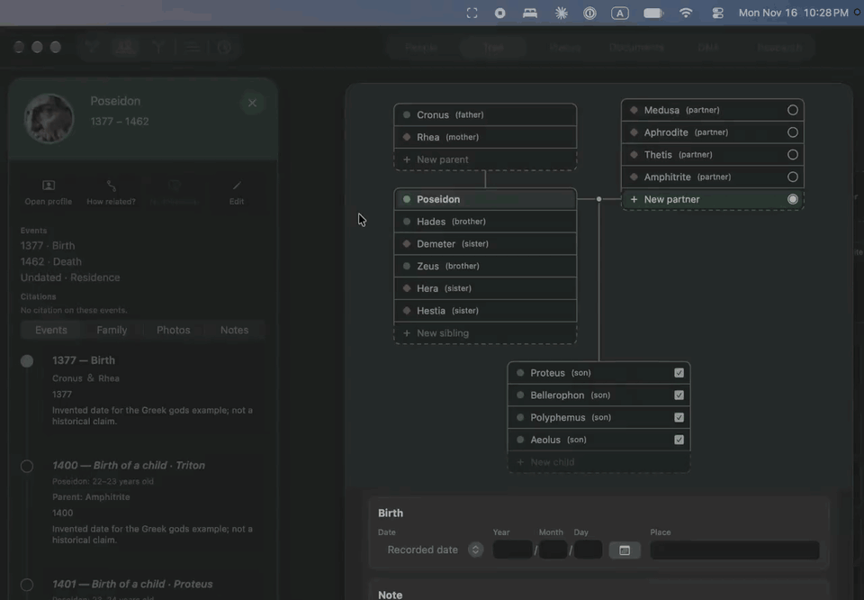

# ScreenClip

**File bugs as you go, without breaking your flow.**

A native macOS menu bar app for the small things you notice: a clipped button, confusing copy, a missing detail, or an idea. Use the default **⌘⇧2** (Command–Shift–2) shortcut to start a capture from anywhere while ScreenClip is running. Select a region, add a note if you want one, and keep going. ScreenClip keeps the image and the context together. Codex, Claude Code, or Grok Bot does the follow-up.

  

<em>Keep reports, captures, and agent conversations together.</em>

## Capture a report

Use the global **⌘⇧2** shortcut or choose **Screenshot task** from the menu bar. Choose **Text task** to file a written observation directly. You can change the shortcut in Settings, including if the default is already in use.

  

<em>Select a region, say what’s wrong, mark it up, and submit. Then follow the report from the menu bar or the queue until the fix is merged.</em>

## Download

The public download is a notarized disk image on GitHub Releases:

[Download for Mac](https://github.com/lludo/ScreenClip/releases/latest/download/ScreenClip.dmg)

The current release is 1.0.3, which updates itself from now on; see the [release notes](docs/release/v1.0.3.md) and the [1.0.0 notes](docs/release/v1.0.0.md) for everything in the first release. The app is free. An optional tip is separate from the download. There is no Mac App Store build: the sandbox blocks `git` and `gh`, which the app has to run. Details are in [Release and distribution](docs/release/README.md).

The downloadable build is for Apple Silicon Macs (arm64); Intel Macs should build from source. Requires **macOS 14 or later**, a local Git repository, GitHub CLI, and one of Codex, Claude Code, or Grok Bot.

## Quick start

1. **Build and install** with Xcode, or `bash scripts/run.sh`. The shared scheme installs `/Applications/ScreenClip.app`. Signing setup and the first-run checklist are in [Getting started](docs/getting-started.md).
2. **Add a project** (repository, base branch, routing, validation command) and **connect an agent** in Settings. For Grok Bot, copy **POST to** and **key** from the assistant's ScreenClip reports routine into **Connect Grok Bot**. Set **System default**, or a **Project default** when one project should use another provider.
3. Press **⌘⇧2** (or your configured shortcut), select a region, and submit. ScreenClip suggests a project. You can correct it before the report is sent.

Each report keeps its own agent conversation and an isolated Git worktree. ScreenClip opens a GitHub pull request. Automatic merge runs only when the project allows it and the checks pass. Merged fixes show up under **To retest**.

## Documentation

The full map is the [documentation index](docs/README.md).

- [Getting started](docs/getting-started.md) — requirements, install or build, first capture
- [User guide](docs/user-guide.md) — the queue, moving a report, privacy, screen recording
- [Coding agents](docs/agents/README.md) — Codex, Claude Code, and Grok Bot
- [Architecture](docs/architecture.md) — the store, worktrees, and who owns merge
- [Development](docs/development.md) — tests, CI, contributing
- [Release and distribution](docs/release/README.md) — release notes, the notarized DMG, and the publishing checklist
- [Roadmap](docs/roadmap.md) — what is still open
- [Website](docs/website.md) — [screenclipai.com](https://screenclipai.com)

To contribute, read [CONTRIBUTING.md](CONTRIBUTING.md). Report security problems privately, as described in [SECURITY.md](SECURITY.md).

## License

ScreenClip is source-available under the [PolyForm Noncommercial License 1.0.0](LICENSE.md). It is free for noncommercial use. Commercial licensing is available on request.
