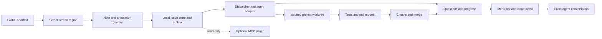

# Architecture

Updated: November 14, 2026. This page describes the app as it is built. [Validation](validation.md) separates what has been exercised from what is still open. Older "proposed design" wording, including the App Store evaluation, has moved to [Release and distribution](release/README.md) and the [archive](archive/README.md).

## What the process is

The native app is built from the shared Xcode project and scheme, including from Terminal and CI. Swift Package Manager supplies the local core library and the command-line tests. A normal run installs `/Applications/ScreenClip.app` so the bundle ID and the development certificate stay stable. Xcode Run and `scripts/run.sh` use the same installer: verify a certificate-signed staging bundle, ask running copies to quit, then replace the installed bundle and roll back on failure. Build-only output stays in DerivedData.

The SQLite store holds a versioned snapshot of projects, issues, ordered captures, activity, questions, and settings. Queued state is the durable outbox. Dispatch uncertainty is written before an external create. A process file lock enforces a single writer, so the writer keeps its last saved snapshot in memory instead of reading the queue back on every save. State changes save immediately. Agent progress lines update memory and are saved within a second, or sooner if another save happens, or on quit (`AppModel.updateIssueSoon`).

Recovery pauses interrupted Codex work for reconciliation. An interrupted Claude Code session continues when no process for that session survived.

Each issue goes to Codex, Claude Code, or Grok Bot. Codex and Claude Code share the local contract in [Coding agents](agents/README.md). Grok Bot is the remote webhook. The optional plugin is read-only (`list_issues`, `get_issue`). The app is the only writer.

A project runs up to `AppSettings.parallelReportLimit` reports at once (default 3, allowed range 1–6). A slot is held only while ScreenClip is dispatching, running, or publishing that report. A report that is merely waiting on CI does not hold one. Git worktree creation and removal for one project are serialized, because concurrent `git fetch` and `git worktree` calls share ref locks. Merges in one project are taken one at a time.

Each issue has an optional-on-decode `reportNumber`, assigned on store save and shown as `#234`. A snapshot-level `nextReportNumber` is committed with the issues, so deletions cannot recycle a number. Legacy reads assign missing numbers in creation order. Report numbers span all projects and include drafts. UUIDs stay the internal identity.

## Shape

Capture persistence and the return to the previous app do not wait for the agent, a question, or pull-request automation.

Grok Bot does not take the local edit turn. ScreenClip still uses a worktree, but only to commit and push approved screenshots, then it watches the pull request the assistant opens.

## Native components

| Component | Responsibility |
| --- | --- |
| Menu bar | SwiftUI `MenuBarExtra`, plus a queue window |
| Shortcut | Carbon `RegisterEventHotKey`, conflict detection, user-editable shortcut |
| Capture | AppKit overlays and ScreenCaptureKit still images (`SCScreenshotManager`, macOS 14) |
| Composer | Note, project, agent, and an annotation canvas |
| Context | Source app and window; optional Safari or Chrome URL |
| Store | SQLite plus image files in Application Support |
| Dispatcher | Outbox, one job per issue, retry, the per-project limit, worktrees |
| Agents | Codex and Claude Code locally; Grok Bot as a webhook ([details](agents/README.md)) |
| GitHub | PR identity, checks, mergeability, and confirmed merge, via `gh` |

Permission is decided by the ScreenCaptureKit call, not by gating on `CGPreflightScreenCaptureAccess`. A monitor separates an actual macOS denial, an executable replaced since launch, and other capture errors. Diagnostics record API error codes and build metadata in a bounded log, without image content or captured source context. Ad-hoc signatures change identity across rebuilds and can drop screen-recording permission, which is why local installs use a development certificate.

The composer supports freehand, arrows, rectangles, ellipses, text, and redaction. The same renderer draws the editing preview and the exported image. Redactions ignore the selected color and stay opaque black. For a redacted capture the unredacted crop is not stored. Unredacted captures can keep a local original for editing. Agents receive the approved derivative only.

**Hide ScreenClip during capture** is on by default. When it is off, the queue, settings, and popover stay visible and ScreenClip's windows are included in the capture filter. Selection overlays are created only after the frozen display images exist, so they are not in the shot either way.

Full-display backdrops used while dragging a selection stay in memory and are discarded. They are never sent as hidden context.

## Routing

Each project stores bundle IDs, website origins and path prefixes, local ports, and session overrides. Routing uses evidence captured before the overlay opens, then shows the destination. A browser's bundle ID alone never selects a repository. Missing or conflicting evidence saves **Needs project**.

Changing the project before a chat or worktree exists reassigns the report. After agent work exists, **Move to project** cancels the old report and queues a copy. It does not move a worktree or a pull request between repositories. See the [user guide](user-guide.md#filed-under-the-wrong-project).

## Worktrees, checks, and merge

Each local run gets one worktree under Application Support and a `screenclip/<id>` branch. Older issues may still use `codex/screenclip-<id>`. The branch starts from `origin/<base>` after a fetch when the repository has an origin, so unpushed commits on the tester's checkout never enter a pull request. Without an origin it starts from the local base. The tester's checkout is never the working directory.

Grok Bot uses a different branch name: `screenclip/<reportNumber>-<slug>-<workspace>`. `<workspace>` is the first eight characters of the issue workspace id, so a follow-up after a merge does not reuse the merged branch. The committed files live under `.screenclip/<reportNumber>/`. Pull-request discovery looks for a body containing `ScreenClip: #<reportNumber>` whose head is that branch. Automatic merge waits while any `.screenclip/` path is still in the pull request.

Validation runs the project's command in the worktree with a one-hour limit, allowing full native test suites to finish. The source fingerprint must be unchanged afterward. Initialized submodules are fingerprinted by their checked-out commit; uninitialized ones by a fixed marker. Child processes have git redirect variables removed. A timed-out command has its process tree terminated. Coding agents also run without GitHub tokens. ScreenClip pushes and opens pull requests itself. Pull-request bodies redact `NAME=value` assignments and token-like strings from the validation command.

Merge requires the current pull-request head, a passed validation of that head, required host checks, required reviews, no unresolved question, and no newer capture revision. An empty validation command is not a pass. If the base branch moves, ScreenClip merges the latest base into the issue branch and revalidates. A conflicting base merge is aborted. After a confirmed merge, ScreenClip deletes the issue branch from origin and removes the worktree and local branch. A worktree with uncommitted changes is kept.

## Distribution boundary

Release builds set `ENABLE_HARDENED_RUNTIME = YES` and `ENABLE_APP_SANDBOX = NO`. Debug builds set both to `NO`. The shipping entitlement is `com.apple.security.automation.apple-events`. The bundle id is `com.mirageteam.screenclip`. The app is a menu-bar agent (`LSUIElement`).

There is no Mac App Store configuration. `scripts/release-dmg.sh` refuses a signature that contains the App Sandbox entitlement, because a sandboxed child cannot run `/usr/bin/git` or read Homebrew `gh`. The evidence is in [Mac App Store sandbox](release/app-store-sandbox.md). The shipping path is in [Direct distribution](release/direct-distribution.md).

The local worker runs while ScreenClip is running and the Mac is awake. Closing the popover does not stop it. A login item is optional (`SMAppService.mainApp`) and off until the user turns it on. Grok Bot is the exception: the remote assistant keeps working if the Mac sleeps.

Secrets ScreenClip stores for itself go in the Keychain. Public pull-request content does not automatically include private screenshots. Deleting a report locally does not delete an agent chat or a pull request that already exists.

## Source layout

| Path | Contents |
| --- | --- |
| `Sources/ScreenClip/` | The app: `AppModel`, capture, queue, settings, and `ExternalAssistantKeychain` |
| `Sources/ScreenClip/AgentWorker*.swift` | Scheduling (`AgentWorker`), Codex (`+Codex`), Claude Code (`+Claude`), Grok Bot (`+External`), validation and merge (`+Publishing`) |
| `Sources/ScreenClip/AgentPrompt.swift` | The prompt and result schema local agents receive |
| `Sources/ScreenClip/Localization.swift` | String Catalog lookup. User-written report text is not translated |
| `Sources/ScreenClipCore/` | Model, store, routing, agent clients, processes, Git, GitHub, and `MergeGuard` |
| `plugins/screenclip/` | Read-only MCP server and the Claude Code `fix-report` skill |
| `scripts/` | Build, install, package, test, localization, probes, and the read-only queue review |
| `website/` | The static site deployed as the Vercel project `screenclip-website` |
