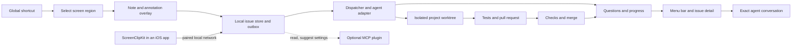

# Architecture

Updated: November 26, 2026. This page describes the app as it is built. [Validation](validation.md) separates what has been exercised from what is still open. The App Store evaluation is under [Release and distribution](release/README.md). Superseded proposals are in the [archive](archive/README.md).

## What the process is

The native app is built from the shared Xcode project and scheme, including from Terminal and CI. Swift Package Manager supplies the local core library and the command-line tests. A normal run installs `/Applications/ScreenClip.app` so the bundle ID and the development certificate stay stable. Xcode Run and `scripts/run.sh` use the same installer: verify a certificate-signed staging bundle, ask running copies to quit, then replace the installed bundle and roll back on failure. Build-only output stays in DerivedData.

The SQLite store holds a versioned snapshot of projects, issues, ordered captures, activity, questions, and settings. Queued state is the durable outbox. Dispatch uncertainty is written before an external create. A process file lock enforces a single writer, so the writer keeps its last saved snapshot in memory instead of reading the queue back on every save. Read failures are surfaced rather than loaded as empty queues, and read-only connections cannot save snapshots or modify capture files. State changes save immediately. Agent progress lines update memory and are saved within a second, or sooner if another save happens, or on quit (`AppModel.updateIssueSoon`).

Recovery reconciles and resumes acknowledged interrupted Codex work and reports stranded on command or file approval when the project uses automatic review or full access. Genuine unanswered questions, manual approval projects, uncertain dispatches, active chats, and mismatched worktrees still wait for user action. An interrupted Claude Code session continues when no process for that session survived.

Each issue goes to Codex, Claude Code, or Grok Bot. Codex and Claude Code share the local contract in [Coding agents](agents/README.md). Grok Bot is the remote webhook. The optional plugin reads the queue (`task_summary`, `list_projects`, `list_issues`, `get_issue`) can suggest project settings (`propose_project_settings`), which change nothing until the tester accepts them, and can ask ScreenClip to close a report the agent fixed itself (`close_issue`), which the app checks against GitHub or `origin` before applying; the app bundles its server and Settings can register it with Claude Code or Codex. The app is the only writer of the queue and its settings.

A project runs up to `AppSettings.parallelReportLimit` reports at once (default 3, allowed range 1–6). A slot is held only while ScreenClip is dispatching, running, or publishing that report. A report that is merely waiting on CI does not hold one. Git worktree creation and removal for one project are serialized, because concurrent `git fetch` and `git worktree` calls share ref locks. Merges in one project are taken one at a time.

Each issue has an optional-on-decode `reportNumber`, assigned on store save and shown as `#234`. A snapshot-level `nextReportNumber` is committed with the issues, so deletions cannot recycle a number. Legacy reads assign missing numbers in creation order. Report numbers span all projects and include drafts. UUIDs stay the internal identity.

## Shape

Capture persistence and the return to the previous app do not wait for the agent, a question, or pull-request automation.

Grok Bot does not take the local edit turn. ScreenClip still uses a worktree, but only to commit and push approved screenshots, then it watches the pull request the assistant opens.

## Native components

| Component | Responsibility |
| --- | --- |
| Menu bar | SwiftUI `MenuBarExtra`, plus a queue window |
| Shortcut | Carbon `RegisterEventHotKey`, conflict detection, user-editable shortcut |
| Capture | AppKit overlays and ScreenCaptureKit still images (`SCScreenshotManager`, macOS 14) |
| Composer | Note, project, issue destination, agent with model and effort (`AgentModelMenu`), and an annotation canvas |
| Context | Source app and window; optional Safari or Chrome URL |
| Store | SQLite plus image files in Application Support |
| Dispatcher | Outbox, one job per issue, retry, the per-project limit, worktrees |
| Agents | Codex and Claude Code locally; Grok Bot as a webhook ([details](agents/README.md)) |
| GitHub | PR identity, checks, mergeability, and confirmed merge, via `gh` |
| iOS | `IOSReceiver`: Bonjour `_screenclip._tcp` listener, pairing, sealed frames, reports from ScreenClipKit ([details](ios-sdk.md)) |

Permission is decided by the ScreenCaptureKit call, not by gating on `CGPreflightScreenCaptureAccess`. A monitor separates an actual macOS denial, an executable replaced since launch, and other capture errors. Diagnostics record API error codes and build metadata in a bounded log, without image content or captured source context. Ad-hoc signatures change identity across rebuilds and can drop screen-recording permission, which is why local installs use a development certificate.

The composer supports freehand, arrows, rectangles, ellipses, text, and redaction. The same renderer draws the editing preview and the exported image. Redactions ignore the selected color and stay opaque black. For a redacted capture the unredacted crop is not stored. Unredacted captures can keep a local original for editing. Agents receive the approved derivative only.

**Hide ScreenClip during capture** is on by default. When it is off, the queue, settings, and popover stay visible and ScreenClip's windows are included in the capture filter. Selection overlays are created only after the frozen display images exist, so they are not in the shot either way.

Full-display backdrops used while dragging a selection stay in memory and are discarded. They are never sent as hidden context.

## Routing

Each project stores bundle IDs and website rules, including schemes, ports, and path prefixes. Routing uses evidence captured before the overlay opens, then shows the destination. A browser's bundle ID alone never selects a repository. Missing or conflicting evidence saves **Needs project**.

Changing the project before a chat or worktree exists reassigns the report. After agent work exists, **Move to project** cancels the old report and queues a copy. It does not move a worktree or a pull request between repositories. See the [user guide](user-guide.md#filed-under-the-wrong-project).

## Worktrees, checks, and merge

Each local run gets one worktree under Application Support and a `screenclip/<id>` branch. A new project takes its repository's default branch as the base (`origin/HEAD`, else `main` or `master` when only one exists); a base branch the repository doesn't have is flagged in the project editor, and a report stops with a message naming the branch to use instead of git's "invalid reference". Older issues may still use `codex/screenclip-<id>`. The branch starts from `origin/<base>` after a fetch when the repository has an origin, so unpushed commits on the tester's checkout never enter a pull request. Without an origin it starts from the local base. The tester's checkout is never the working directory.

Grok Bot uses a different branch name: `screenclip/<reportNumber>-<slug>-<workspace>`. `<workspace>` is the first eight characters of the issue workspace id, so a follow-up after a merge does not reuse the merged branch. The committed files live under `.screenclip/<reportNumber>/`. Pull-request discovery looks for a body containing `ScreenClip: #<reportNumber>` whose head is that branch. Merge waits while that hand-off folder is still in the pull request, because Grok Bot's last commit deletes it.

With a project's **Commit screenshots to the repository** setting on (the default), local-agent publishing commits the evidence under `.screenclip/pr/` with the fix and links it at that commit. The files stay in the repository through the merge; ScreenClip does not remove them or gate a merge on them. With it off, no `.screenclip/` path is staged. Evidence failures are warnings and never stop publishing. See [Commit screenshots to the repository](agents/README.md#commit-screenshots-to-the-repository).

Validation runs the project's command in the worktree with a one-hour limit, allowing full native test suites to finish. The source fingerprint must be unchanged afterward. Initialized submodules are fingerprinted by their checked-out commit; uninitialized ones by a fixed marker. Child processes have git redirect variables removed. A timed-out command has its process tree terminated. Coding agents and the validation command run without GitHub tokens. ScreenClip pushes and opens pull requests itself. Pull-request bodies redact `NAME=value` assignments and token-like strings from the validation command.

Merge requires the current pull-request head, a passed validation of that head, required host checks, required reviews, no unresolved question, and no newer capture revision. An empty validation command is not a pass. If the base branch moves, ScreenClip merges the latest base into the issue branch and revalidates. It does the same as soon as GitHub reports the pull request as conflicting, with or without automatic merge, because a conflict never clears by waiting. A conflicting base merge is left in progress in the worktree and handed to the local agent as a repair turn: the agent resolves the conflict markers in the files, and ScreenClip's next commit concludes the merge after validation. Publication stops while conflict markers remain. When no repair turn is left, or the report belongs to Grok Bot, the merge is aborted and the report moves to **Needs you**. After a confirmed merge, ScreenClip deletes the issue branch from origin and removes the worktree and local branch. A worktree with uncommitted changes is kept.

Worktrees are also freed when a report stops needing one: a fix merged from another branch (`ScreenClip #N` or `close_issue` with a pull request), an agent's `close_issue`, archiving, deleting, and new evidence on a merged report (which continues in a new worktree). Those go through `GitWorkspace.reasonToKeep`: the folder must be one of ScreenClip's own worktrees under Application Support (never the tester's checkout), with no uncommitted or untracked changes, no merge in progress, and no commit on its HEAD or branch that is not on origin. Without an origin, a worktree with any commit of its own is kept. Only the worktree and local branch are removed; the remote branch stays, since another session's pull request may use it. The check and the removal run as one serialized workspace change. On launch, ScreenClip applies the same rule to worktrees of finished or archived reports and to ScreenClip worktrees no report refers to. When a report continues after its local branch was freed, `GitWorkspace.prepare` starts from `origin/<branch>` if origin still has it.

A worktree can also be deleted outside ScreenClip, for example by whoever resolved and merged the pull request by hand. Pull-request state is read with `gh pr view <url>` from the worktree, or from the project checkout once the worktree is gone, so a merge on GitHub is still recorded for a report at **PR open**, **Needs you**, or **Failed**. Grok Bot discovery falls back the same way. An open pull request whose worktree is gone waits for a merge or close on GitHub. A local agent is never started in a missing worktree: the report fails with an explanation, and Continue checks its branch out again at the same path (`GitWorkspace.prepare` first clears git's stale registration) and sends the full prompt.

## Distribution boundary

Release builds set `ENABLE_HARDENED_RUNTIME = YES` and `ENABLE_APP_SANDBOX = NO`. Debug builds set both to `NO`. The shipping entitlement is `com.apple.security.automation.apple-events`. The bundle id is `com.mirageteam.screenclip`. The app is a menu-bar agent (`LSUIElement`).

There is no Mac App Store configuration. `scripts/release-dmg.sh` refuses a signature that contains the App Sandbox entitlement, because a sandboxed child cannot run `/usr/bin/git` or read Homebrew `gh`. The evidence is in [Mac App Store sandbox](release/app-store-sandbox.md). The shipping path is in [Direct distribution](release/direct-distribution.md).

The local worker runs while ScreenClip is running and the Mac is awake. Closing the popover does not stop it. A login item is optional (`SMAppService.mainApp`) and off until the user turns it on. Grok Bot is the exception: the remote assistant keeps working if the Mac sleeps.

Secrets ScreenClip stores for itself go in the Keychain. Pull requests include the flattened report screenshots and retested After images, and Grok Bot evidence is pushed to a `screenclip/` branch, so anyone who can read the repository can read them. Committed Before / After evidence stays in the repository, base branch included, until the tester removes it. Unredacted originals are never published. Deleting a report locally does not delete an agent chat or a pull request that already exists.

## Source layout

| Path | Contents |
| --- | --- |
| `Sources/ScreenClip/` | The app: `AppModel`, capture, queue, settings, and `ExternalAssistantKeychain` |
| `Sources/ScreenClip/AgentWorker*.swift` | Scheduling (`AgentWorker`), Codex (`+Codex`), Claude Code (`+Claude`), Grok Bot (`+External`), fixes that landed outside ScreenClip and `close_issue` checks (`+ExternalFix`), validation and merge (`+Publishing`) |
| `Sources/ScreenClip/AgentPrompt.swift` | The prompt and result schema local agents receive |
| `Sources/ScreenClip/Localization.swift` | String Catalog lookup. User-written report text is not translated |
| `Sources/ScreenClipCore/` | Model, store, routing, agent clients and their model/effort catalog (`AgentModels`), processes, Git, GitHub, and `MergeGuard` |
| `Sources/ScreenClipWire/` | Shared with the iOS SDK: annotation model, Core Graphics renderer, iOS report types, and the local-network protocol |
| `Sources/ScreenClipKit/` | The iOS SDK (Debug builds only) |
| `Examples/ScreenClipKitDemo/` | A small iOS app with ScreenClipKit installed the Debug-only way |
| `plugins/screenclip/` | MCP server (reads the queue, proposes settings, closes fixed reports), the Claude Code `fix-report` skill, and the `install-ios-sdk` skill |
| `scripts/` | Build, install, package, test, localization (including the `CompileStringCatalog` SwiftPM build plugin), probes, and the read-only queue review |
| `website/` | The static site deployed as the Vercel project `screenclip-website` |
