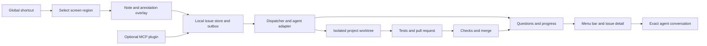

# ScreenClip technical design

Updated: November 13, 2026. The native app and local worker are implemented. The design below retains future options where identified; [validation evidence](validation.md) distinguishes verified behavior from remaining work.

## Implemented choices

The native app is built through the shared Xcode project/scheme, including from Terminal and CI. Swift Package Manager supplies its local core library and command-line tests. Normal runs install and launch `/Applications/ScreenClip.app`, preserving the bundle ID and development certificate across builds. Xcode Run and `scripts/run.sh` use the same installer: verify a certificate-signed staging bundle, ask running copies to quit, then replace the installed bundle with rollback on failure. Build-only output stays in DerivedData. A local ignored certificate configuration supplies development signing. The SQLite store persists a versioned snapshot containing projects, issues, ordered captures, activity, questions, and settings. Queued state acts as the durable outbox; dispatch uncertainty is persisted before external creation. A process file lock enforces a single writer, and recovery pauses interrupted work for reconciliation.

The native worker uses Codex app-server over stdio. A live synthetic test passed image input, a structured question, restart/resume, and a reply in the same chat; the desktop app's chat reader recognized both turns. The actual native worker also completed a synthetic fix through local validation, GitHub CI, PR creation, and confirmed merge in a private fixture. Automatic desktop sidebar project membership failed in the installed 0.1.6 association check: app-server persisted a canonical project ID, while the desktop still used a different project identity for the same repository. Exact chat links and repository context work; sidebar grouping remains a compatibility gap.

The optional plugin is currently read-only (`list_issues`, `get_issue`) and requires Python 3. Native dispatch and status writes have one owner. Hosted MCP Events, plugin mutations/leases, and shared desktop-process ownership remain future integrations. Reply in ScreenClip for app-owned runs; cancel before manually editing the same worktree in another client.

Each issue has an optional-on-decode `reportNumber`, assigned on store save and displayed as `#234`. A snapshot-level `nextReportNumber` is committed with the issues, so deletions cannot recycle a number. Legacy reads assign missing numbers in creation order with a UUID tie-breaker, retaining array order; the next writable save persists the migration. Saves preserve existing ID-to-number bindings and the stored high-water mark even if the caller passes a stale counter. The app publishes the numbered snapshot only after a successful save. Report numbers span all projects and include drafts; UUIDs remain the internal identity. Exact number searches include archived reports and bypass project/status filters. The read-only plugin exposes the number and accepts it in `get_issue.issue_id` alongside UUIDs.

## Recommended structure

The architecture serves the primary product goal: capture feedback as it is noticed and return the user to their current task. Capture persistence and return-to-app focus must not wait for Codex work, a clarification, or PR automation. Repeated small captures should stay lightweight even while earlier observations are being processed. See the [product specification](product-spec.md#problem-and-intended-outcome) for the capture-first value proposition.

Build a native Swift application with SwiftUI for the composer and queue, AppKit for selection windows and focus behavior, a durable local store, and agent adapters. Keep the native capture experience independent of the particular agent handoff mechanism.

The diagram is a proposed ownership model. In particular, the agent-facing connections require compatibility testing for each agent.

## Native components

| Component | Proposed responsibility |
| --- | --- |
| Menu bar | SwiftUI `MenuBarExtra`, with a queue window for longer interactions |
| Shortcut registration | System global hotkey registration, conflict detection, and a user-editable shortcut |
| Capture coordinator | AppKit overlays plus ScreenCaptureKit still-image capture |
| Composer | SwiftUI note/project controls and an annotation canvas; retain original image and editable marks |
| Context adapters | Source app/window identity; optional browser and build-context adapters |
| Issue store | SQLite metadata/event history and image files in Application Support |
| Dispatcher | Outbox delivery, issue ownership, retry, capacity, and worktree allocation |
| Agent adapters | Codex and Claude Code transport, conversation identity, progress, questions, cancellation, and recovery ([details](agents/README.md)) |
| Git provider adapter | PR identity, checks, mergeability, and confirmed merge state |

Apple documents menu bar utility support through [MenuBarExtra](https://developer.apple.com/documentation/swiftui/menubarextra) and still-image capture through [SCScreenshotManager](https://developer.apple.com/documentation/screencapturekit/scscreenshotmanager). The latter is available from macOS 14. Use the content-filter/configuration capture path for that baseline; availability-check newer convenience APIs.

Request screen-capture permission when the user first invokes capture, and provide a useful denied/revoked-permission state. Test full-screen Spaces, multiple displays with different scales and coordinate origins, keyboard cancellation, focus restoration, and exclusion of ScreenClip's own overlays from the result. Prototype frozen-frame selection so menus and transient UI do not change while the tester drags.

Permission availability is decided by the actual ScreenCaptureKit operation, rather than gating it on `CGPreflightScreenCaptureAccess`. A monitor distinguishes an actual macOS denial, an executable replaced since launch, and other capture errors. It can recheck on return from System Settings or on demand. Capture diagnostics record API error codes and build/event metadata in a bounded local log, without image content or captured source context. The bottom banner has a subtle border/shadow and permission recovery actions. Rebuilding a running bundle is refused by the Terminal builder. Use a stable development certificate for repeated local builds; [Apple DTS confirms](https://developer.apple.com/forums/thread/819406) that ad-hoc signatures change identity across rebuilds and can invalidate screen-capture permission.

The immediate composer supports freehand, arrows, rectangles, ellipses, text, and redaction, with per-mark color and normalized stroke width. Optional style fields preserve compatibility with previously saved captures. The same renderer draws the editing preview and exported image; redactions ignore the selected color and remain opaque black.

The **Hide ScreenClip during capture** preference is on by default. When off, capture keeps the queue/settings/popover visible and includes the app's windows in ScreenCaptureKit's filter, allowing reports about ScreenClip itself. Capturing its visible popover records ScreenClip as the source. When on, the shortcut closes/hides those surfaces and excludes ScreenClip windows. Selection overlays are created only after the frozen display images exist, so they never appear in either mode. The optional persisted preference also decodes older queues without a migration: missing values use the default, while explicit choices are preserved.

Capture only user-selected evidence. Hold temporary full-display selection backdrops in memory and discard them after capture/cancel. Never forward those backdrops as hidden context. Flatten opaque redactions into the submitted derivative before annotations. For a redacted capture, do not persist the unredacted crop at all. Unredacted captures can retain a local original for editing; submitted image inputs use the approved derivative. This avoids relying on read-root isolation that is unavailable in the development runtime's generated protocol.

## Project and context inference

Store explicit routing rules per registered project: native bundle IDs/build paths, web origins and path prefixes, local ports, and session overrides. Route from evidence captured before opening the overlay, then present the destination to the user.

Browser URL access needs an adapter and consent; it is not implied by having a screenshot. Evaluate browser automation permissions versus a small browser extension. Treat unavailable URLs and window titles as missing/weak evidence. OCR can suggest a destination but cannot authorize repository access. Use a session override until enough context exists for a reliable switch.

Use an explicit confidence/reason field rather than an unobservable guess. Never infer the repository from a generic browser bundle ID alone. A **Needs project** issue is a valid durable outcome when routing is ambiguous.

## Agent integrations

The capture pipeline is agent-neutral. The dispatcher prepares a worktree, sends one prompt with approved screenshots to the issue's agent, and receives a structured `implemented` / `question` / `blocked` result. ScreenClip then validates, publishes, and verifies merges itself. The shared contract, agent selection, readiness gating, and the checklist for adding an agent are in [Coding agents](agents/README.md). Each agent has its own page:

- [Codex](agents/codex.md): app-server transport, thread identity, desktop deep links, project association, and Codex plugin options.
- [Claude Code](agents/claude-code.md): headless stream-json turns, session identity, sandbox, sign-in, and the Claude Code plugin.
- [External assistant proposal](agents/proposals/external-assistant.md): a possible remote hand-off.

Serialize work on an individual issue. Append new evidence as a later turn. When the user continues work in the agent's own client, reconcile that activity; do not let two clients independently start competing turns. Separate transport progress from product outcomes, and verify PR, check, and merge claims with the source-control host before promoting the state. A normal successful agent response alone is insufficient.

## Local model and durable delivery

| Record | Key fields |
| --- | --- |
| Project | Local repo identity/path, Git remote, routing rules, target branch, validation/merge policy |
| TestingSession | Project, label, start/end, shared notes, tested build evidence |
| Issue | UUID, permanent local report number, project/session, title, lifecycle state, input revision, archive/read flags |
| Capture | Issue ID, sequence, note, asset references, immutable context snapshot |
| Asset | Original/approved derivative/thumbnail, hashes, dimensions, annotation document |
| AgentRun | Issue/revision, attempt ID, worker/chat/turn bindings, stage, timestamps, lease |
| QuestionReply | Issue/run, correlation ID, message, delivery/answer state |
| PullRequest | Run, host/repository, PR number/URL, head SHA, checks, merge commit |
| Event / Outbox | Event ID, issue revision, durable operation, attempt/acknowledgment state |

Write assets atomically before committing their references and outbox entry. Acknowledged submissions must survive app failure; clean up orphan assets on recovery. Preserve an editable annotation document alongside the flattened approved image.

Use at-least-once delivery with idempotent consumers. Persist an operation ID before starting external work; if a response is lost, reconcile against the external operation/chat/PR before retrying. When the external interface cannot prove whether creation succeeded, surface an uncertain operation instead of blindly creating another chat or PR.

The current in-app worker uses an exclusive process lock and one active job per issue, with revision checks. Recovery proceeds only after reconciling existing activity. It allows one active editing job per repository and parallelism across repositories; CI waits release editing capacity. New input invalidates completion for earlier revisions. Renewable leases and fencing would be required before introducing external queue writers or independent worker processes.

## Worktrees, checks, and automatic merge

Record the tested revision separately from the agent's base revision. Create one worktree and branch per issue run; use the project base branch and keep the user's testing checkout untouched. Local uncommitted test changes need explicit source evidence; do not silently copy or discard them.

The user's chosen default authorizes automatic implementation, PR creation, and merge. Store that policy per project during onboarding. Merge only the current PR head after relevant validation and required host checks pass, required reviews are satisfied, no unresolved question blocks the fix, and no new capture revision is pending. Missing validation configuration is not equivalent to passing checks.

Serialize merges per repository. If the base branch changes, apply the project's update/revalidation policy before merging. Confirm the merge with the host, record the merge commit, and notify with retest instructions. Keep CI and deployment as distinct facts. Do not force-update the tester's checkout or restart their running app automatically.

## Distribution and lifecycle

Proposed first delivery is a signed, notarized direct-download app. Evaluate sandbox restrictions and child-process execution before choosing an App Store route. For public release, decide whether to bundle a compatible Codex runtime or require an installed one; verify licensing, redistribution, updates, signatures, and a supported version range. Avoid depending on an undocumented binary inside another app's bundle.

The app must explain when work runs: the proposed local worker operates while ScreenClip is running and the Mac is awake. Closing the popover does not stop it; quitting and sleep have explicit recovery behavior. A login item is optional. A permanent launch agent or hosted worker is a later choice.

Keep captures in per-user Application Support, outside source repositories. Use Keychain for ScreenClip's own secrets and supported source-control authentication. Public PR content must not inherit private screenshots automatically. Deleting an issue locally must explain any independent retained Codex history or PR; stop an active run before removing its working evidence.

## Current environment observations

Read-only checks on November 13, 2026 found an otherwise empty Git repository with no remote configured. The Mac reports macOS 27.0.1 and Swift 6.4.2, with Xcode selected.

`/opt/homebrew/bin/codex --version` failed because its expected native binary was missing from the npm installation (`ENOENT`). The development checks used the configurable runtime at `/Applications/ChatGPT.app/Contents/Resources/codex-cli/bin/codex`, version `0.169.0-alpha.11.1`. Its ChatGPT sign-in, agent conversations, and PR workflow were verified. GitHub authentication also passed outside the build sandbox; its earlier failure was restricted Keychain access. The plugin was tested over stdio but was not installed into the public directory. No Developer ID signing identity was available.
