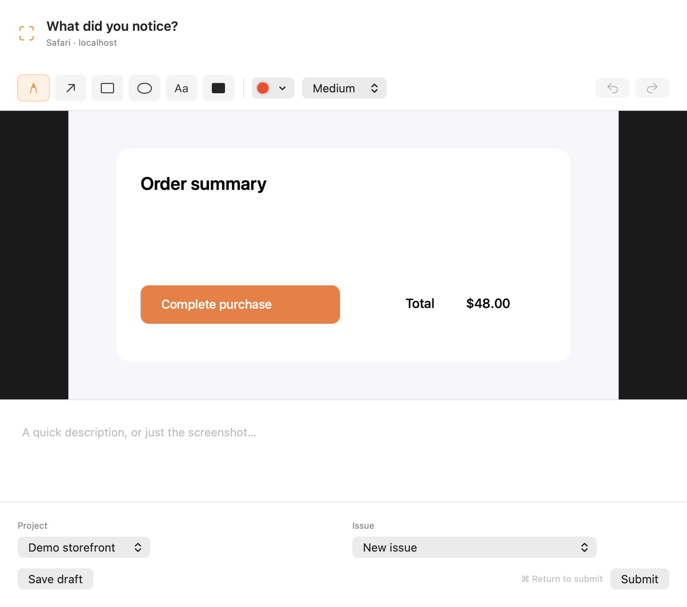

# ScreenClip validation

Updated: November 14, 2026. Development host: macOS 27.0.1, Xcode 27.2, Swift 6.4.2, Apple Silicon.

This page records what is verified and how. What is still open is in the [roadmap](roadmap.md#open-gates).

## Current status

The checks below describe the coverage and the live verification completed on the development host as of the date above. Run the commands under [Reproduce](#reproduce) for current results. CI also checks shell syntax and builds the website and Xcode Debug and Release configurations.

| Area | Automated | Hands-on or live | Not yet verified |
| --- | --- | --- | --- |
| Capture and markup | Annotation pixels (orientation, ellipse, pen width, opaque redaction); style round-trip; four permission regressions | Region capture → markup → submit on this Mac, from the signed app in Applications, with permission retained across an installed update | Multiple monitors and scales, Spaces, transient menus, every ScreenClip surface with hiding on and off |
| Queue and store | Persistence, single writer, report numbers (legacy migration, no reuse), drafts, related captures, archive rules, delete rules, feedback search, badge counts, export | Installed updates kept both projects and all reports | Downgrade to an older build (see store versioning in the roadmap) |
| Routing | Ambiguity, URL boundaries, most-specific website rule, case-insensitive schemes | — | Browser URL permission prompts |
| Codex | JSON-RPC correlation and timeouts, questions and replies in one thread, cancellation during project lookup and before turn acknowledgement, authentication (nine regressions) | A synthetic fix through validation, GitHub CI, PR, and confirmed merge in a private fixture; restart and resume in the same chat | Desktop sidebar grouping fails; see below |
| Claude Code | Fake-CLI client and worker tests: arguments, evidence input, progress, structured and fenced results, usage, failures, cancellation, missing sessions, timeouts are wired, detection, holding work while signed out | The installed CLI (2.1.128) has every flag and sandbox setting used; plugin manifests pass `claude plugin validate` | A live fix through PR and merge; permanent plugin installation; an interactive plugin fix |
| Grok Bot | `ExternalAssistantTests`: payload encoding, slug and branch names, opt-in, idempotent retry, pull-request matching, the `.screenclip/` merge guard, detection, the Authorization header on a test POST (line breaks rejected, removed on a cross-host redirect), Keychain update in place. `ExternalAssistantAppTests`: stays in the agent list, submit refused until configured and the project opts in, a restart during the POST stays retryable | — | A live webhook, an evidence push to a real repository, pull-request discovery, and auto-merge while `.screenclip/` is still present; see [Grok Bot](agents/external-assistant.md#verification-status) |
| Git and GitHub safety | Changed-source rejection, stale head and revision merge rejection, worktree from `origin/<base>` excludes unpushed commits, worktree cleanup, GitHub remote parsing, PR body redaction | Fixes published and merged through GitHub PRs | — |
| Process handling | A background grandchild holding the pipe cannot hang a command; a timeout terminates the whole process tree; agents get no GitHub tokens | — | — |
| Plugin and scripts | MCP server: approved images only, private fields excluded, invalid arguments and malformed requests answered with errors; queue review: read-only access, searches, archive eligibility | — | Public directory submission |

## Repository association review

A synthetic run confirmed repository context, worktree isolation, and runtime project association, but the chat appeared ungrouped in the desktop sidebar on the tested Codex version. Runtime association and desktop sidebar placement are separate checks; a successful app-server response does not establish the latter. **Open in Codex** provides an exact chat link.

To repeat it (creates a synthetic Codex chat and uses normal account usage):

```sh
/Applications/ScreenClip.app/Contents/MacOS/ScreenClip \
  --integration-project-link \
  --data-dir "$PWD/.local/project-link-check-NEW" \
  --integration-repo "$PWD" \
  --integration-image "$PWD/docs/screenshots/composer-preview.png"
```

Inspect `integration-result.json`, the runtime's `thread/read`, and the desktop sidebar listing separately. The test stops at a question; publishing is disabled by its empty validation command and automatic merge is off.

## Reproduce

Run the suites listed under [Development in the README](../README.md#development). To render native previews with synthetic data:

```sh
bash scripts/build.sh
build/DerivedData/Build/Products/Debug/ScreenClip.app/Contents/MacOS/ScreenClip --render-preview --data-dir "$PWD/.local/preview-new"
```

Use a new preview data directory each time. Preview mode pauses processing and does not send images to an agent. Rendering needs WindowServer access, so run it outside a restricted terminal sandbox.

Live diagnostics, which create real agent conversations and use account usage:

- `scripts/probe_codex.py --codex /path/to/codex` performs a read-only Codex handshake.
- The `ScreenClipProbe` executable runs two Codex model turns with a synthetic image and a disposable repository.
- `scripts/create_integration_fixture.py` creates a private `OWNER/screenclip-integration-*` repository. `ScreenClip --integration-run` then performs real PR and merge operations in that fixture only. Never point it at a production repository.

## Native previews

These use synthetic sample observations, not user screen content.



[Queue preview](screenshots/queue-preview.png)
